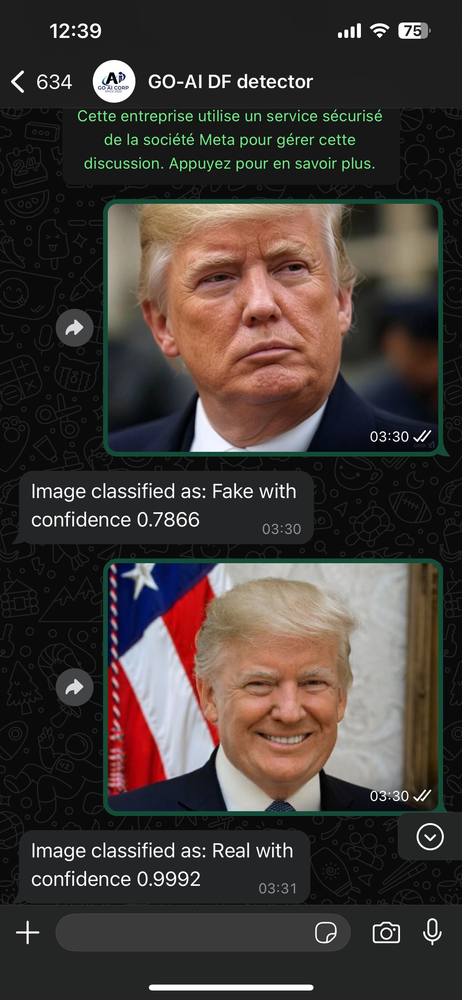
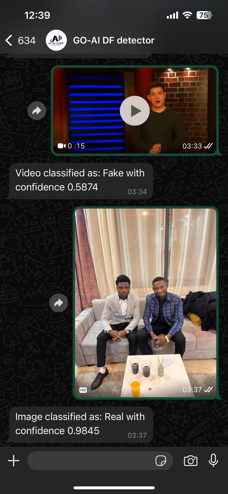
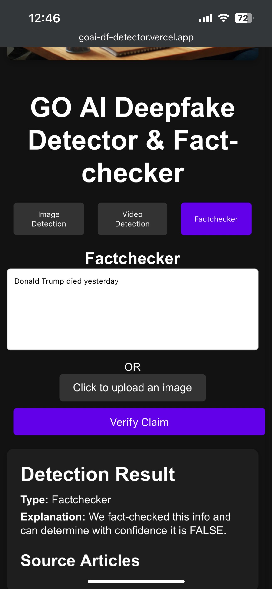
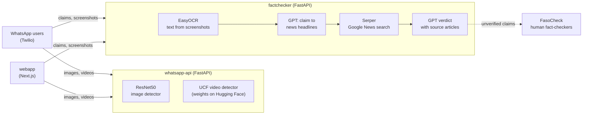

# Deepfake Detector and Fact-Checker

Tools for detecting manipulated media and verifying claims, built in early 2025 at GO AI Corp as part of a UNICEF-supported program to counter misinformation in Burkina Faso. The system checks images, videos and text claims, and serves the results through WhatsApp and a web app.

<table>
  <tr>
    <td align="center"><br><sub>Image check on WhatsApp</sub></td>
    <td align="center"><br><sub>Video check on WhatsApp</sub></td>
    <td align="center"><br><sub>Claim verification in the web app</sub></td>
  </tr>
</table>

Screen recordings: [WhatsApp detector](demo/whatsapp-df-detector.mp4), [WhatsApp fact-checker](demo/whatsapp-factchecker.mp4), [web app](demo/webapp-demo.mp4).

## Components

| Folder | What it does | Stack |
|---|---|---|
| [`image-detection/model-comparison`](image-detection/model-comparison) | Fine-tunes and compares ResNet50, VGG16, DenseNet121 and MobileNet for real/fake face images, with k-fold training | PyTorch, torchvision |
| [`image-detection/resnet50`](image-detection/resnet50) | Training and inference code for the ResNet50 image detector that was deployed | PyTorch |
| [`video-detection/training`](video-detection/training) | Fine-tunes the UCF detector (Xception backbone, 32 frames per video) on top of [DeepfakeBench](https://github.com/SCLBD/DeepfakeBench) | PyTorch, DeepfakeBench |
| [`video-detection/inference`](video-detection/inference) | Gradio app that loads the fine-tuned video weights from the Hugging Face Hub ([`ArissBandoss/deepfake-video-classifier`](https://huggingface.co/ArissBandoss/deepfake-video-classifier)) | Gradio, Hugging Face Spaces |
| [`audio-detection`](audio-detection) | Early experiments on synthetic speech detection: dataset survey and wav2vec2-base fine-tuning on the Fake-or-Real (FoR) dataset | Transformers, Datasets |
| [`factchecker`](factchecker) | Claim verification API: reads text from screenshots with OCR, turns the claim into news headlines with GPT, searches Google News through Serper, then asks GPT for a true/false verdict grounded in the articles it found, which are returned as sources | FastAPI, EasyOCR, OpenAI, Serper |
| [`whatsapp-api`](whatsapp-api) | WhatsApp webhook that runs the image and video detectors on media sent to the bot | FastAPI, Twilio, Docker |
| [`webapp`](webapp) | Web front end for image detection, video detection and fact-checking | Next.js 13, TypeScript |

## How it fits together



Both APIs ship with a Dockerfile and were deployed on Google Cloud Run, with the web app on Vercel. Claims the system cannot verify were meant to be forwarded to human fact-checkers at FasoCheck.

## Running locally

Each folder is self-contained, with its own `requirements.txt` (or `package.json`) and Dockerfile where relevant. For example, the fact-checker API:

```bash
cd factchecker
pip install -r requirements.txt
# set OPENAI_API_KEY, GOOGLE_NEWS_API_KEY (Serper), TWILIO_SSID and TWILIO_SECRET_KEY in .env
uvicorn app.main:app --port 8080
```

The video detector follows the DeepfakeBench workflow; see [`video-detection/training/README.md`](video-detection/training/README.md) for data preparation, training and evaluation.

## Data

- Images: real faces from CelebA, VGGFace2 and IMDB-WIKI; fakes from Celeb-DF and FaceForensics++.
- Videos: FaceForensics++ and Celeb-DF, preprocessed with the DeepfakeBench pipeline.
- Audio: Fake-or-Real (FoR); other candidate datasets are listed in [`audio-detection/README.md`](audio-detection/README.md).

## Status

This was a prototype built in a few weeks. The hosted demos (Cloud Run APIs, WhatsApp numbers, Hugging Face Space) are no longer running, and the audio detector did not go past early experiments. Model weights are not stored in this repository.

## History and licenses

This repository brings together work previously kept in separate repositories (`goai-deepfake-detector-and-factchecker`, `Deepfake_Videos_Detection`, `DeepfakeBench_Inference`, `DeepfakeBench` and `fake-audio-detection`), with their commit history preserved.

- `video-detection/training` is based on [DeepfakeBench](https://github.com/SCLBD/DeepfakeBench) by SCLBD (CUHK-Shenzhen), released under [CC BY-NC 4.0](video-detection/training/LICENSE). Use of that code is limited to non-commercial purposes.
- `audio-detection` is released under the [MIT License](audio-detection/LICENSE).

## Authors

Aristide BANDAOGO and Wendyellé A. Alban NYANTUDRE.
